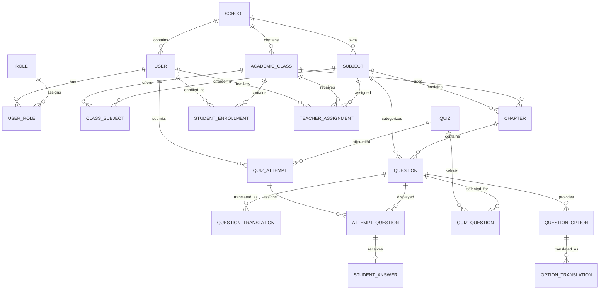

# Database architecture

## Overview

The database is a PostgreSQL-oriented relational schema for one modular FastAPI application. SQLAlchemy 2.0 typed models use the shared declarative base and Alembic owns schema evolution. SQLite is supported for isolated tests.

Core UUID primary keys use SQLAlchemy's `Uuid` type. Timestamps are timezone-aware, and database defaults use UTC server time for new records.

## Entity groups

- **Organization:** `schools`, `users`, `roles`, `user_roles`
- **Academics:** `academic_classes`, `subjects`, `class_subjects`, `chapters`
- **Participation:** `student_enrollments`, `teacher_assignments`
- **Question bank:** `questions`, `question_translations`, `question_options`, `option_translations`
- **Assessments:** `quizzes`, `quiz_questions`, `quiz_attempts`, `attempt_questions`, `student_answers`

## Relationships



## Integrity rules

- School codes, subject codes/names, and class identities are unique within their owning school.
- Class/subject links, chapters, teacher assignments, enrollments, questions, quizzes, and attempts use composite foreign keys to keep school and academic context consistent. Questions are school-owned and their school must match the subject and optional author/updater.
- A role is a separate database entity. Users are linked through `user_roles`, allowing multiple future roles without duplicate user records.
- Student and teacher historical records use foreign keys and restrict academic deletion where referenced. Enrollment academic years must match the class year; only one active enrollment per student, school, and year is allowed. A transfer keeps the previous row inactive and creates an active row for the new class.
- Academic chapters are unique by class, subject, and chapter number/title.
- Question and option translations are unique per question/option and language. Since the current question type is single-choice, a partial unique index allows at most one correct option per question. Questions can be reused across quizzes, but each quiz-question association must match the quiz's chapter and subject.
- Attempt question rows snapshot the selected language and exact question text. Their ordered `option_order_snapshot` JSON entries retain each displayed option's ID, key, order, and translated text; `display_order` retains the question's position. These snapshots must be copied when an attempt is created and must not be reconstructed from editable question-bank rows when rendering an existing attempt.
- Each attempt assigns a question once and has a one-response record at most for each attempt-question.
- A selected option is constrained to the attempt question's question; a missing selected option represents an unanswered question. Referenced options cannot be deleted while historical answers use them. Answer correctness is nullable until backend evaluation; the database does not replace API authorization or trusted backend writes.
- Attempt score must equal correct count, counts must sum to the question total, percentage must match the score to two decimal places, and completion timestamps must match attempt status. Future backend services must calculate these values from persisted answers and the answer key rather than trust client-provided totals.
- Restricted deletes preserve historical academic records. Translations, options, and attempt-answer cascades remove only data that belongs exclusively to their parent.

## PostgreSQL configuration

Supabase is the managed PostgreSQL host; the application continues to use its existing SQLAlchemy, Alembic, and FastAPI authentication/authorization. Create a Supabase project and use the **Session Pooler** connection string (port `5432`) in `backend/.env`:

```text
DATABASE_URL=<SUPABASE_POSTGRES_CONNECTION_STRING>
```

Include `sslmode=require` in the URL (the backend adds it when omitted). URL-encode special characters in the password. Treat the URL as a secret and do not put it in frontend configuration or commit it. Create `backend/.env` from `backend/.env.example` only if the file does not already exist; do not overwrite existing environment files.

Docker is not required for PostgreSQL. From `backend`, configure the URL and manually apply the existing migrations with `alembic upgrade head`. This command is not run automatically.

## Migrations

Run migrations from `backend`:

```powershell
.\.venv\Scripts\Activate.ps1
alembic upgrade head
alembic current
alembic history
```

Validate SQL for PostgreSQL-compatible migration content without opening a live connection:

```powershell
alembic upgrade head --sql
```

Create the next migration after model changes:

```powershell
alembic revision --autogenerate -m "add next domain"
```

Review every generated migration before applying it.

## Database tests

Database tests use an isolated in-memory SQLite database with foreign-key enforcement:

```powershell
python -m pytest tests/test_database_models.py tests/test_health.py -q
```

SQLite covers model relationships and constraints. PostgreSQL-specific behavior, native enum definitions, and live migration execution require a configured PostgreSQL database. The migration SQL can be reviewed offline with Alembic, but applying migrations against a real database requires a backup and a separately verified deployment procedure.

## Adding a future model

1. Add a typed module under `app/models`.
2. Import it in `app/models/__init__.py`.
3. Add focused relationships, indexes, and constraints.
4. Run `alembic revision --autogenerate -m "describe change"` against a disposable PostgreSQL database.
5. Review and test the migration in PostgreSQL and SQLite where applicable.
6. Add isolated database tests and repository/service operations.
